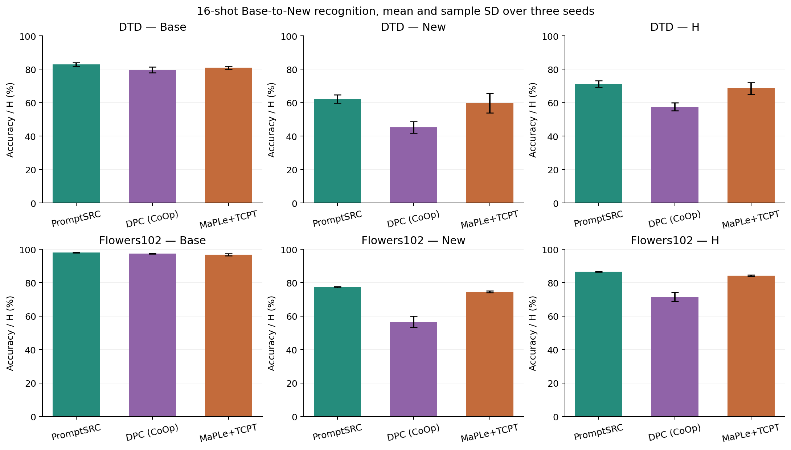
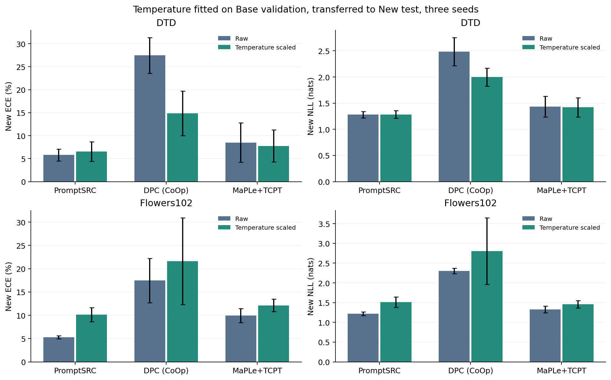

# CLIP 云端实验

2026 年 11 月 10 日在 RTX 4090 D 上完成的 CLIP 提示学习实验。使用 ViT-B/16、16-shot Base-to-New、DTD 与 Flowers102，随机种子为 1、2、3。资料整理自已通过 SHA256 核查的云端实验本地备份。

## 快速访问

| 内容 | 入口 |
| --- | --- |
| B、E 总结与 DPC 扩展结果 | [实验总报告](reports/E.md) |
| MaPLe、PromptSRC、MaPLe+TCPT 的完整结果 | [方案 B 报告](reports/B.md) |
| 数据准备、预验收与运行过程 | [执行记录](reports/execution.md) |
| 实际环境与版本 | [云端环境记录](docs/environment.md) · [pip freeze](records/pip_freeze.txt) |
| 运行入口、依赖与数据恢复 | [复用说明](docs/reproduce.md) |
| 正式实验协议 | [B 执行方案](docs/protocol-B.md) · [B 固定配置](records/config_manifest.json) · [E 固定配置](records/E_config_manifest.json) |
| 逐次结果、温度与配对差值 | [B 结果表](outputs/B/tables) · [E 结果表](outputs/E/tables) |
| PNG 与 PDF 图 | [B 图表](outputs/B/figures) · [E 主比较图](outputs/E/figures/main_comparison) |
| 训练代码 | [B 工作副本](code/PromptSRC_expB) · [E 工作副本](code/DPC_expE) |
| 完整性记录与本地检查点索引 | [仓库核查](records/repository_checks.json) · [检查点清单](records/checkpoints.json) |

## 实验规模

| 项目 | B | E 新增 | 合计 |
| --- | --- | --- | --- |
| 正式训练阶段与最终检查点 | 18 | 12 | 30 |
| Base/New 测试预测 | 36 | 24 | 60 |
| Base 验证预测与温度 | 18 | 12 | 30 |
| 冻结 CLIP 参照预测 | 4 | 复用 B | 4 |
| 预测文件 | 58 | 36 | 94 |

B 比较 MaPLe、PromptSRC、MaPLe+TCPT。E 增加 CoOp 与 DPC，每个种子先训练 CoOp，再用对应检查点初始化 DPC。原始配置、训练日志、预测 logits、温度、采样审计与验收记录均按运行保存。

## 主比较结果

数值为三个种子的均值 ± 样本标准差。准确率、H、ECE 以百分数表示。完整配方与结果解释见实验总报告。

| 数据集 | 方法 | Base ↑ | New ↑ | H ↑ | New ECE ↓ |
| --- | --- | --- | --- | --- | --- |
| DTD | PromptSRC | 82.91 ± 1.17 | 62.28 ± 2.44 | 71.12 ± 1.94 | 5.80 ± 1.29 |
| DTD | DPC（CoOp） | 79.63 ± 1.67 | 45.17 ± 3.46 | 57.56 ± 2.32 | 27.46 ± 3.91 |
| DTD | MaPLe+TCPT | 80.86 ± 0.96 | 59.70 ± 5.78 | 68.56 ± 3.55 | 8.49 ± 4.28 |
| Flowers102 | PromptSRC | 97.97 ± 0.20 | 77.45 ± 0.28 | 86.51 ± 0.21 | 5.26 ± 0.32 |
| Flowers102 | DPC（CoOp） | 97.34 ± 0.19 | 56.57 ± 3.37 | 71.52 ± 2.63 | 17.45 ± 4.73 |
| Flowers102 | MaPLe+TCPT | 96.74 ± 0.63 | 74.54 ± 0.56 | 84.20 ± 0.38 | 9.93 ± 1.53 |





## 下载

浏览报告、代码、CSV 和图片可以直接使用上面的入口。克隆仓库可以获得代码、环境配置、训练日志、94 份预测及结果图表。

```bash
git clone git@github.com:bityang15/CLIP-Cloud-Experiment.git
cd CLIP-Cloud-Experiment
python tools/verify_archive.py
```

30 个最终检查点合计 7,425,156,120 字节，按用户选择保留在本地。检查点清单记录相对于仓库根目录的路径、大小和 SHA256，便于对应各次训练。将本地检查点放回清单所示位置后，可运行 `python tools/verify_archive.py --with-checkpoints` 核对完整备份。[检查点清单](records/checkpoints.json)

## 目录

```text
code/         正式实验工作副本、Dassl 依赖与 DePT 适配参考
datasets/     官方划分、类别名与 SPLE 标注
downloads/    原始 SPLE 标注包
outputs/B/    B 训练日志、配置、预测、CSV 与图
outputs/E/    E 训练日志、配置、预测、CSV 与图
records/      原始验收、来源、逐样本清单、哈希、运行状态
reports/      实验报告与执行记录
scripts/      数据准备、环境检查、分析及归档脚本
docs/         实验协议、环境与复用说明
tools/        归档完整性检查
```

## 来源

| 代码来源 | 固定提交 |
| --- | --- |
| [PromptSRC](https://github.com/muzairkhattak/PromptSRC) | `bb95c77b634d63488f2cad81ff4a72d53bdd06d5` |
| [TCPT](https://github.com/ashshaksharifdeen/TCPT) | `729232f3be19c8b7d31b9933a55f172e96ac4ef4` |
| [DPC](https://github.com/JREion/DPC) | `01e6b599d6515c38f4d723a8ea844ac4d1abfadd` |
| [DePT](https://github.com/Koorye/DePT) | `d4ff41684bac42da30ebb6898496772dec3157f2` |
| [Dassl.pytorch](https://github.com/KaiyangZhou/Dassl.pytorch) | `c61a1b570ac6333bd50fb5ae06aea59002fb20bb` |

第三方代码保留各自许可证。B 的工程差异、E 的适配差异与代码逐文件哈希均有归档。[B 实现记录](records/implementation_files.json) · [B 补丁](records/implementation.patch) · [E 实现记录](records/E_implementation_files.json) · [E 补丁](records/E_implementation.patch)
