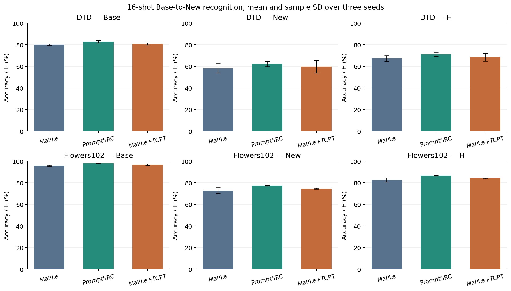
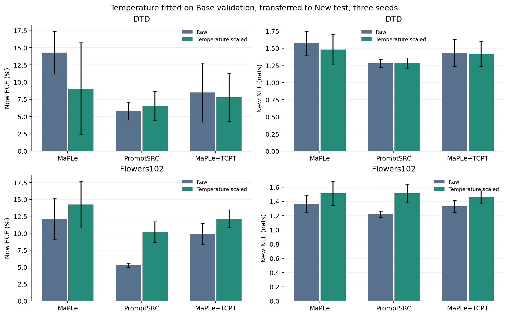

# 方案 B 实验汇报

本轮按《实验计划_B执行版》执行，实验日期为 2026 年 11 月 10 日，时间采用北京时间。18 次正式训练和预测于 17 时 48 分完成，离线分析于 19 时 02 分通过验收。

## 1 完成范围

| 交付项 | 实际完成 |
| --- | --- |
| 正式训练 | 2 个数据集 × 3 个方法 × 3 个种子，共 18 次 |
| 测试预测 | Base、New 各 18 份，共 36 份 |
| 校准验证预测 | Base 验证集 18 份 |
| 温度拟合 | 每个模型单独拟合，共 18 份 |
| 冻结 CLIP 参照 | 两个数据集各 Base/New，共 4 份 |
| 最终检查点 | 18 个 |
| 结果表 | 9 个 CSV |
| 结果图 | 4 组，每组均有 PNG 和 PDF |

正式运行全部采用 `attempt01`。六组 MaPLe/TCPT 的配对初始化、随机状态及前三批输入核对通过。全部模型的固定批次检查点保存重载、跨进程预测重载、在线与离线指标核对通过。18 个温度均通过逐样本 top-1 一致性核查，搜索边界命中数为零。[分析验收记录](../records/analysis_checks.json) [正式运行状态](../records/B_progress.json)

## 2 实验协议

采用 CLIP ViT-B/16、224 × 224 输入、16-shot Base-to-New 和种子 1、2、3。先按官方少样本逻辑抽样，再筛选 Base 类。三种方法共用同种子的训练与验证清单，测试时分别给定 Base 或 New 候选类别集合。

| 数据集 | 总图像 | Base/New 类数 | 每种子 Base 训练 | 每种子 Base 验证 | Base 测试 | New 测试 |
| --- | --- | --- | --- | --- | --- | --- |
| DTD | 5640 | 24/23 | 384 | 96 | 864 | 828 |
| Flowers102 | 8189 | 51/51 | 816 | 204 | 1053 | 1410 |

训练集每类 16 张，Base 验证集每类 4 张。train、val、test 的图像身份交集均为零。训练监督使用 Base 训练标签，温度拟合使用独立 Base 验证标签。New 标签用于既定最终评测与诊断。图像、权重、划分、类别映射和逐种子清单均保存校验值。[数据验收记录](../records/data_checks.json) [逐种子清单](../records/manifests)

| 方法 | 训练轮数 | 初始学习率 | batch size | 最终权重 |
| --- | --- | --- | --- | --- |
| MaPLe | 5 | 0.0035 | 4 | 第 5 轮 |
| PromptSRC | 20 | 0.0025 | 4 | 第 20 轮的官方 GPA 聚合 |
| MaPLe+TCPT | 5 | 0.0035 | 4 | 第 5 轮 |

MaPLe 与 TCPT 共用训练器、网络、初始化、数据顺序和优化配方，由正则开关形成配对。TCPT 使用 `CE - 0.1 × mean(m) + 0.01 × Var(m) + 5 × L_mom`，其中间隔统计、文本矩匹配和预测导出使用 FP32。PromptSRC 保留自己的官方训练配方，因此三方法主表反映整套方法配置的表现。[固定配置](../records/config_manifest.json)

准确率、H 和 ECE 均以百分数表示。H 在每个种子内按 `2 × Base × New / (Base + New)` 计算后汇总。表中均值 ± 标准差采用三个种子的样本标准差，`ddof=1`。ECE 主结果使用 10 个等宽、右闭置信度箱，另保存 15、20 箱敏感性。NLL 采用稳定 log-softmax，以自然对数计。

## 3 原始识别结果

| 数据集 | 方法 | Base ↑ | New ↑ | H ↑ |
| --- | --- | --- | --- | --- |
| DTD | MaPLe | 80.02 ± 0.64 | 58.17 ± 4.30 | 67.29 ± 2.66 |
| DTD | PromptSRC | 82.91 ± 1.17 | 62.28 ± 2.44 | 71.12 ± 1.94 |
| DTD | MaPLe+TCPT | 80.86 ± 0.96 | 59.70 ± 5.78 | 68.56 ± 3.55 |
| Flowers102 | MaPLe | 95.88 ± 0.54 | 72.79 ± 2.72 | 82.74 ± 1.94 |
| Flowers102 | PromptSRC | 97.97 ± 0.20 | 77.45 ± 0.28 | 86.51 ± 0.21 |
| Flowers102 | MaPLe+TCPT | 96.74 ± 0.63 | 74.54 ± 0.56 | 84.20 ± 0.38 |

PromptSRC 在两个数据集上均取得三种方法中最高的平均 Base、New 和 H。TCPT 相对配对 MaPLe 的平均 H 在 DTD 提高 1.26 个百分点，在 Flowers102 提高 1.46 个百分点。[完整主表](../outputs/B/tables/summary_raw.csv)

## 4 原始校准结果

| 数据集 | 方法 | Base ECE ↓ | New ECE ↓ | Base NLL ↓ | New NLL ↓ |
| --- | --- | --- | --- | --- | --- |
| DTD | MaPLe | 3.66 ± 0.58 | 14.28 ± 3.10 | 0.6605 ± 0.0170 | 1.5733 ± 0.1757 |
| DTD | PromptSRC | 2.76 ± 0.51 | 5.80 ± 1.29 | 0.5687 ± 0.0177 | 1.2798 ± 0.0605 |
| DTD | MaPLe+TCPT | 2.41 ± 0.66 | 8.49 ± 4.28 | 0.6105 ± 0.0385 | 1.4337 ± 0.1967 |
| Flowers102 | MaPLe | 3.59 ± 0.14 | 12.14 ± 3.05 | 0.1530 ± 0.0150 | 1.3647 ± 0.1172 |
| Flowers102 | PromptSRC | 5.07 ± 0.29 | 5.26 ± 0.32 | 0.1070 ± 0.0022 | 1.2191 ± 0.0439 |
| Flowers102 | MaPLe+TCPT | 3.95 ± 1.40 | 9.93 ± 1.53 | 0.1382 ± 0.0122 | 1.3296 ± 0.0847 |

TCPT 相对 MaPLe 的平均 New ECE 在 DTD 下降 5.79 个百分点，在 Flowers102 下降 2.20 个百分点，平均 New NLL 分别下降 0.1396 和 0.0351。Flowers102 的 Base ECE 与 Base NLL 方向不同，TCPT 的平均 Base ECE 略高，Base NLL 较低，因此结果解释同时保留两项指标。[逐次原始结果](../outputs/B/tables/runs_raw.csv)

将分箱数改为 15 或 20 后，两个数据集的平均原始 New ECE 排序仍为 PromptSRC、TCPT、MaPLe，具体数值有所变化。全部方法、种子、候选组及原始/缩放结果均保存在分箱敏感性表中。[分箱敏感性](../outputs/B/tables/ece_bins_sensitivity.csv)

## 5 Base 验证温度缩放

每个模型在 `[0.05, 20]` 的 401 个对数等距候选温度上最小化自己的 Base 验证 NLL，候选中显式包含 1。数值并列时选择最接近 1 的温度。最优温度范围为 0.6674–1.4542，同一温度用于该模型的 Base 与 New 测试预测。逐样本 top-1 核对全部通过，汇总准确率和 H 一致。

| 数据集 | 方法 | New ECE 原始 → 缩放 | New NLL 原始 → 缩放 |
| --- | --- | --- | --- |
| DTD | MaPLe | 14.28 → 9.05 | 1.5733 → 1.4788 |
| DTD | PromptSRC | 5.80 → 6.54 | 1.2798 → 1.2842 |
| DTD | MaPLe+TCPT | 8.49 → 7.77 | 1.4337 → 1.4192 |
| Flowers102 | MaPLe | 12.14 → 14.24 | 1.3647 → 1.5151 |
| Flowers102 | PromptSRC | 5.26 → 10.15 | 1.2191 → 1.5118 |
| Flowers102 | MaPLe+TCPT | 9.93 → 12.13 | 1.3296 → 1.4578 |

DTD 上，温度缩放改善 MaPLe 与 TCPT 的平均 New ECE/NLL，PromptSRC 的两项指标略有上升。Flowers102 上，三种方法的平均 Base 测试 ECE/NLL 均下降，而 New ECE/NLL 均上升。本轮观察体现出 Base 验证校准向 New 类迁移的差异。[逐模型温度记录](../outputs/B/tables/temperature_runs.csv) [缩放后均值与标准差](../outputs/B/tables/summary_temperature.csv)

## 6 配对结果与种子波动

下表为同种子 TCPT 减 MaPLe。H 差值越高越好，ECE 和 NLL 差值越低越好。

| 数据集 | 种子 | ΔH | ΔNew ECE | ΔNew NLL |
| --- | --- | --- | --- | --- |
| DTD | 1 | -5.362 | +0.248 | +0.2545 |
| DTD | 2 | +4.725 | -11.532 | -0.2855 |
| DTD | 3 | +4.421 | -6.079 | -0.3878 |
| Flowers102 | 1 | +0.591 | -2.337 | -0.0531 |
| Flowers102 | 2 | -0.271 | +0.920 | +0.0207 |
| Flowers102 | 3 | +4.052 | -5.198 | -0.0729 |

DTD seed 1 的 TCPT New 准确率比 MaPLe 低 9.30 个百分点，其余两个种子方向相反。Flowers102 seed 2 也出现小幅退化。本轮三个种子的平均收益和方向变化一同保留，结论限于这两个数据集与固定配方。[完整配对表](../outputs/B/tables/paired_tcpt_vs_maple.csv)

可靠性图按计划固定展示 seed 1，下方保存各置信度箱的样本量。其 DTD 配对方向与三种子均值存在差异，应结合上表和误差条阅读。[原始可靠性图](../outputs/B/figures/reliability_seed1_raw.png) [温度缩放可靠性图](../outputs/B/figures/reliability_seed1_temperature.png) [分箱原始数据](../outputs/B/tables/reliability_seed1.csv)

## 7 冻结 CLIP 单模板参照

| 数据集 | 候选组 | 准确率 | ECE | NLL |
| --- | --- | --- | --- | --- |
| DTD | Base | 53.24 | 4.76 | 1.5902 |
| DTD | New | 60.39 | 9.05 | 1.3478 |
| Flowers102 | Base | 71.70 | 3.03 | 1.0890 |
| Flowers102 | New | 77.45 | 4.88 | 0.9870 |

DTD 模板为 `{} texture.`，Flowers102 模板为 `a photo of a {}, a type of flower.`。冻结参照为确定性单值。DTD 上 MaPLe 与 TCPT 的平均 New 准确率低于该参照，PromptSRC 高于该参照。Flowers102 上 PromptSRC 的平均 New 准确率与参照四舍五入后相同，三种适配方法的平均 New NLL 均高于参照。[冻结参照表](../outputs/B/tables/clip_reference.csv)

## 8 实际资源消耗

硬件为单张 RTX 4090 D 24GB，系统为 Ubuntu 22.04，独立环境为 Python 3.10.22、PyTorch 2.4.1、torchvision 0.19.1、CUDA 运行库 12.1。依赖一致性、GPU FP16 更新、真实数据训练和导出均有验收记录。

| 数据集 | 方法 | 平均训练秒数 | 训练峰值分配显存 GiB |
| --- | --- | --- | --- |
| DTD | MaPLe | 20.42 | 0.882 |
| DTD | PromptSRC | 101.17 | 1.665 |
| DTD | MaPLe+TCPT | 21.88 | 0.882 |
| Flowers102 | MaPLe | 40.53 | 1.299 |
| Flowers102 | PromptSRC | 206.96 | 1.855 |
| Flowers102 | MaPLe+TCPT | 42.12 | 1.294 |

18 次记录的训练时段累计约 1299.23 秒，即 21.65 分钟、0.361 小时。完整训练、独立进程评测与核查队列的墙钟时间为 2490.49 秒，即 41.51 分钟。18 次 NumPy 温度网格拟合累计约 0.318 秒，输入为已保存的 logits。云服务器租用时长还包含环境准备、数据下载、调试和备份，应按平台账单统计。[逐次成本表](../outputs/B/tables/costs.csv)

显存记录采用 `torch.cuda.max_memory_allocated`。表中训练显存取相应三个种子的最大值。测试耗时为评测循环的实际时间，初始化和检查点核查另列在成本表中。

## 9 工程处理与复现文件

1. 将 MaPLe 配置文件中实际为 2 的训练轮数显式修正为计划规定的 5，PromptSRC 保留官方 20 轮 GPA。
2. 同类检查点重载保留保存的 token 缓冲，以确保 GPA 的精确重载。候选类别改变时重新构建类别缓冲，并保留旧检查点的原回退逻辑。
3. 固定最终轮次检查点，正式预测由独立评测命令生成，训练期间关闭自动评测。评测采用确定性预处理和 cuDNN 确定性设置。
4. 初始环境中使用稳定版 TensorBoard 2.18.0，替代安装源中不可取得的 `tb-nightly`。依赖检查通过，补丁与版本清单已归档。
5. 首轮接口验收发现离线指标的 `accuracy` 字段重复，修正后重跑并补齐在线离线分箱核查，最终采用 `attempt03` 验收结果。相关失败日志保留。
6. 通过独立工作副本接入 TCPT、预测导出、指标、温度拟合和日志接口。正式实现有逐文件 SHA256 清单，原作者源码归档单独保存。
7. 数据文件采用官方来源。Oxford 大文件使用分段下载，作者的三个 Google Drive JSON 经连接器取得后上传，并核对两端校验值。SSH 使用保存的主机指纹，操作审计保存在本地。

以上处理的完整差异与来源均已保存。[工程补丁](../records/implementation.patch) [依赖补丁](../records/dassl_dependency.patch) [源码版本](../records/source_revisions.json) [接口验收](../records/preflight.json) [SSH 操作记录](../records/operations/B_ssh_operations.jsonl)

## 10 本地备份与 E 扩展

云端根目录为 `/root/autodl-tmp/clip-exp`。本地正式结果在当前目录的 `outputs/B/`，环境、清单、核查和日志在 `records/`。证据归档为 `B_evidence.tar.gz`，18 个最终检查点归档为 `B_checkpoints.tar`，归档大小与 SHA256 保存在 `B_package_checks.json`，849 个文件的逐项清单保存在 `B_file_manifest.json`。11 月 10 日 19 时 44 分，本地两份归档及解压后的 849 个文件全部通过大小和 SHA256 核对，18 个检查点和 58 份预测数量正确，B 的 117 个源码文件校验值一致，四组结果图已逐张查看。[本地备份核查](../records/B_local_backup_checks.json)

作者的百度网盘官方标注包已由用户下载提供，六组种子的 Base 16-shot 负样本库核查通过。DPC 独立适配、真实图像验收、完整预跑及预算核查通过后，于 19 时 54 分启用 E。新增的 12 个正式阶段于 21 时 03 分完成，温度拟合、采样审计和表图均通过，本地完整备份于 21 时 18 分通过。E 的实测结果单独汇报，本报告保留 B 的 MaPLe、PromptSRC 和 MaPLe+TCPT 结果。[E 实验汇报](E.md) [E 扩展核查记录](../records/extension_decision.md)
