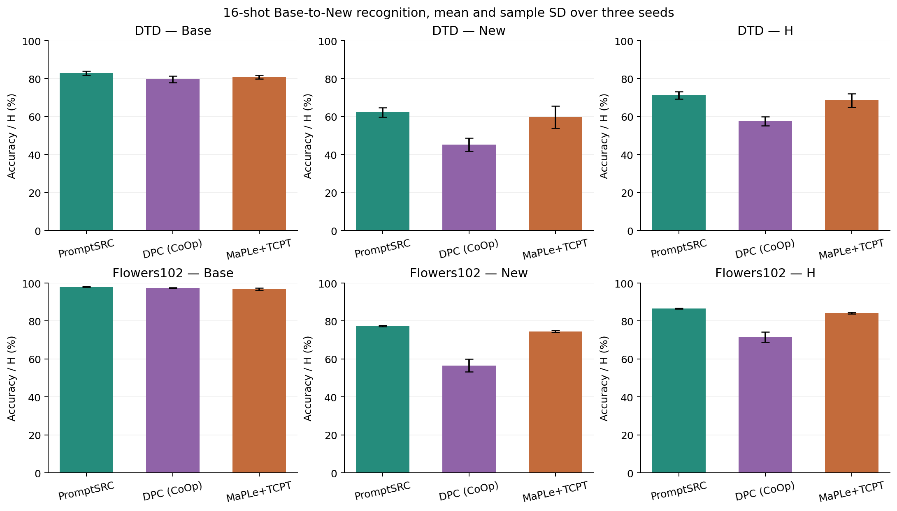
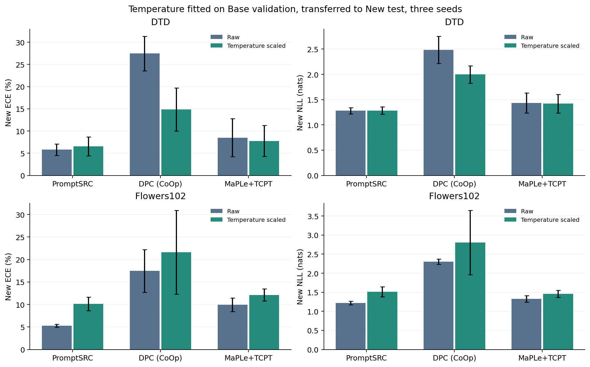

# B 与 E 实验汇总及 DPC 扩展汇报

实验日期为 2026 年 11 月 10 日，时间采用北京时间。方案 E 的 12 个新增训练阶段于 21 时 03 分完成，采样审计、离线指标、温度拟合和图表生成全部通过。B 的完整报告单独保存。[方案 B 实验汇报](B.md)

## 1 实际完成范围

| 项目 | B | E 新增 | 合计 |
| --- | --- | --- | --- |
| 正式训练阶段与最终检查点 | 18 | 12 | 30 |
| Base/New 测试预测 | 36 | 24 | 60 |
| Base 验证预测与温度拟合 | 18 | 12 | 30 |
| 冻结 CLIP 参照 | 4 | 复用 B | 4 |
| 预测文件总数 | 58 | 36 | 94 |

E 新增 CoOp 与 DPC（CoOp）在 DTD、Flowers102 上的 seeds 1、2、3。每个种子先完成 CoOp，再以对应 CoOp 检查点初始化 DPC。全部正式运行均采用 `attempt01`。12 个新增模型的固定批次保存重载、跨进程预测、在线与离线指标核查全部通过。12 个新增温度的逐样本 top-1 核查通过，边界命中数为零。[E 分析验收](../records/E_analysis_checks.json) [运行状态](../records/E_progress.json)

## 2 DPC 的数据与固定配方

共同协议沿用 B 的 CLIP ViT-B/16、16-shot Base-to-New、224 × 224 输入、三个种子和独立 Base 验证集。准确率、H、ECE 以百分数表示，汇总采用三种子均值及样本标准差，`ddof=1`。ECE 主结果使用 10 个等宽右闭置信度箱，补充 15、20 箱。NLL 使用稳定 log-softmax。

| 参数 | 第一阶段 CoOp | 第二阶段 DPC |
| --- | --- | --- |
| 官方配置 | `CoOp/vit_b16.yaml` | `SPLE/CoOp/vit_b16_ep20.yaml` |
| 轮数 | 200 | 20 |
| 上下文长度 | 16 | 16 |
| 初始上下文 | 正态随机初始化，标准差 0.02 | 克隆对应的已训练 CoOp 提示 |
| 类别特定上下文 | False | False |
| 精度 | FP16 | FP16 |
| 初始学习率 | 0.002 | 0.002 |
| 优化器与调度 | SGD、余弦调度 | SGD、余弦调度 |
| 训练 batch size | 32 | 4 |
| Top-K 查询配置 | — | 8 |
| Base/New 提示融合权重 | — | 0.5/0.0 |

上下文长度、初始化和轮数采用上述仓库配置及默认设置，是本次 E 的工程选择。PromptSRC、TCPT 使用 B 已固定的各自配方。主比较展示整套方法设置的实测表现，DPC 的归因对照为对应的 CoOp。[E 固定配置](../records/E_config_manifest.json)

作者的 Google Drive 标注入口返回 404，百度网盘官方备份有效。本次先核查官方链接并打开本机预先安装的百度网盘查看下载入口，用户随后下载并提供 `SPLE_database.rar`。原包大小为 5342205 字节，SHA256 为 `98043c32eb8520f73a2cccecf6f1a10aaefdcca43491f4e41f1323acb768a384`。已解析其中 DTD 与 OxfordFlowers 两份 JSON，并与 B 清单逐项对应。[DPC 官方来源](https://github.com/JREion/DPC/blob/01e6b599d6515c38f4d723a8ea844ac4d1abfadd/README.md)

| 数据集 | 官方训练库图像 | 各种子实际负样本库 | Base 类数 | 每类图像 | 验证、测试图像使用数 |
| --- | --- | --- | --- | --- | --- |
| DTD | 2820 | 384 | 24 | 16 | 0 |
| Flowers102 | 4093 | 816 | 51 | 16 | 0 |

六组清单的每张图像都存在于官方训练库，类别标签匹配。负样本库由同种子的 Base 训练清单裁剪得到，逐个采样路径在训练时执行预算断言。[标注与清单核查](../records/E_annotation_checks.json)

## 3 主比较结果

| 数据集 | 方法 | Base ↑ | New ↑ | H ↑ | New ECE ↓ | New NLL ↓ |
| --- | --- | --- | --- | --- | --- | --- |
| DTD | PromptSRC | 82.91 ± 1.17 | 62.28 ± 2.44 | 71.12 ± 1.94 | 5.80 ± 1.29 | 1.2798 ± 0.0605 |
| DTD | DPC（CoOp） | 79.63 ± 1.67 | 45.17 ± 3.46 | 57.56 ± 2.32 | 27.46 ± 3.91 | 2.4871 ± 0.2689 |
| DTD | MaPLe+TCPT | 80.86 ± 0.96 | 59.70 ± 5.78 | 68.56 ± 3.55 | 8.49 ± 4.28 | 1.4337 ± 0.1967 |
| Flowers102 | PromptSRC | 97.97 ± 0.20 | 77.45 ± 0.28 | 86.51 ± 0.21 | 5.26 ± 0.32 | 1.2191 ± 0.0439 |
| Flowers102 | DPC（CoOp） | 97.34 ± 0.19 | 56.57 ± 3.37 | 71.52 ± 2.63 | 17.45 ± 4.73 | 2.3026 ± 0.0661 |
| Flowers102 | MaPLe+TCPT | 96.74 ± 0.63 | 74.54 ± 0.56 | 84.20 ± 0.38 | 9.93 ± 1.53 | 1.3296 ± 0.0847 |

PromptSRC 在本轮两个数据集上取得最高平均 H，原始 New ECE/NLL 也最低。MaPLe+TCPT 的平均 H 及原始 New 校准指标优于 B 中的配对 MaPLe，种子波动见 B 报告。[主比较原始表](../outputs/E/tables/main_comparison_raw.csv)

## 4 DPC 与 CoOp 的配对结果

| 数据集 | 方法 | Base | New | H |
| --- | --- | --- | --- | --- |
| DTD | CoOp | 81.79 ± 0.71 | 45.17 ± 3.46 | 58.15 ± 2.86 |
| DTD | DPC（CoOp） | 79.63 ± 1.67 | 45.17 ± 3.46 | 57.56 ± 2.32 |
| Flowers102 | CoOp | 98.07 ± 0.24 | 56.57 ± 3.37 | 71.72 ± 2.76 |
| Flowers102 | DPC（CoOp） | 97.34 ± 0.19 | 56.57 ± 3.37 | 71.52 ± 2.63 |

本轮 DPC 相对 CoOp 的平均 Base 在 DTD 下降 2.16 个百分点、Flowers102 下降 0.73 个百分点，平均 H 分别下降 0.59、0.20 个百分点。六个种子的 Base 差值均为负。该观察对应本轮 200+20 轮、16 个随机上下文 token、Base 16-shot 受限负样本库及固定融合权重。[CoOp/DPC 汇总](../outputs/E/tables/summary_raw.csv)

| 数据集 | 种子 | DPC − CoOp 的 Base 差值 | H 差值 |
| --- | --- | --- | --- |
| DTD | 1 | -0.926 | -0.227 |
| DTD | 2 | -1.389 | -0.330 |
| DTD | 3 | -4.167 | -1.210 |
| Flowers102 | 1 | -0.285 | -0.072 |
| Flowers102 | 2 | -0.760 | -0.200 |
| Flowers102 | 3 | -1.140 | -0.332 |

New 融合权重固定为 0，六组 DPC 的完整 New 原始 logits 与对应 CoOp 逐项一致，因此原始 New 准确率、ECE、NLL 一致。在此设置下，配对 H 的变化由 Base 的变化决定。[逐种子配对表](../outputs/E/tables/paired_dpc_vs_coop.csv)

## 5 温度缩放

每个模型只使用自己的 Base 验证预测拟合温度，网格、范围、并列选择和指标实现沿用 B。12 次 E 温度搜索均通过 top-1 核查，边界命中数为零。

| 数据集 | 方法 | New ECE 原始 → 缩放 | New NLL 原始 → 缩放 |
| --- | --- | --- | --- |
| DTD | CoOp | 27.46 → 13.99 | 2.4871 → 1.9840 |
| DTD | DPC（CoOp） | 27.46 → 14.84 | 2.4871 → 1.9976 |
| Flowers102 | CoOp | 17.45 → 23.42 | 2.3026 → 3.2379 |
| Flowers102 | DPC（CoOp） | 17.45 → 21.62 | 2.3026 → 2.8080 |

DTD 上，CoOp 与 DPC 的平均 New ECE/NLL 均下降。Flowers102 上，两者的平均 New ECE/NLL 均上升。DPC 与 CoOp 各自使用自己的 Base 验证温度，因此缩放后的 New 概率质量会有差异。[温度逐次记录](../outputs/E/tables/temperature_runs.csv) [温度缩放汇总](../outputs/E/tables/summary_temperature.csv) [三主方法缩放汇总](../outputs/E/tables/main_comparison_temperature.csv)

## 6 实际采样核查

官方采样器查询 Top-8 类候选，并加入当前正样本，在批次内去除重复负类。实际扩展组大小随查询结果与可用类别变化，完整日志中 DTD 为 1–8 张，Flowers102 为 3–9 张，均包含当前正样本。

| 数据集 | 种子 | 更新数 | 平均组大小 | 9 张图像组数 | 实际使用的不同负样本图像 |
| --- | --- | --- | --- | --- | --- |
| DTD | 1 | 1920 | 4.908 | 0 | 384 |
| DTD | 2 | 1920 | 4.913 | 0 | 384 |
| DTD | 3 | 1920 | 4.902 | 0 | 384 |
| Flowers102 | 1 | 4080 | 6.184 | 6 | 816 |
| Flowers102 | 2 | 4080 | 6.214 | 9 | 816 |
| Flowers102 | 3 | 4080 | 6.232 | 15 | 816 |

本次保留上述官方采样行为，完整记录实际组大小。逐更新核对所有负类互异、与该批正类不重合，正负图像均属于对应种子的 Base 训练清单。六组运行中验证、测试图像使用数均为零，第一阶段提示在每次 DPC 更新前后的校验值一致。[完整采样审计](../records/E_sampling_checks.json)

## 7 实际成本

| 数据集 | CoOp 平均训练秒数 | DPC 第二阶段平均秒数 | DPC 两阶段合计平均秒数 | 第二阶段峰值分配显存 GiB |
| --- | --- | --- | --- | --- |
| DTD | 208.43 | 229.28 | 437.71 | 0.874 |
| Flowers102 | 300.34 | 599.70 | 900.04 | 1.314 |

E 的 12 个训练时段累计 1.115 小时，约 66.89 分钟。首次完整预跑为 519.23 秒，后续队列含对已完成预跑的复核为 4104.10 秒。B 与 E 的全部训练时段合计约 1.476 小时，即 88.54 分钟。平台租用时长还包含环境准备、数据获取、调试、评测和备份，应按实际账单统计。[逐阶段成本](../outputs/E/tables/costs.csv) [DPC 两阶段总成本](../outputs/E/tables/dpc_two_stage_costs.csv)

显存采用 `torch.cuda.max_memory_allocated`，表中取三个种子的最大值。DPC 两阶段总训练成本包含对应 CoOp 的训练，第二阶段成本在表中单列。

## 8 实际工程修改

1. 建立独立 `DPC_expE` 工作副本，通过进程路径加载 DPC 自带的修改版 Dassl。
2. 从官方 DePT 固定提交补齐缺失的训练基类与优化器，保留上游许可证，将缺失的日志导入改用内置输出。
3. 补充包初始化文件，处理首次导入时与 B 同名包的冲突，保留失败日志。
4. 复用同仓库 CoOp 的 CLIP 加载函数，补齐 DPC 分支缺失的模型设计参数。
5. 初始化平行提示时独立克隆张量，避免与第一阶段提示共享存储。逐更新检查第一阶段提示保持相同校验值。
6. converse 模式在训练时还原平行提示，评测时使用融合提示。检查点重载按当前 Base/New 类别重建固定 token 缓冲，并按对应权重构建提示。
7. 两个数据集复用 B 已验收的加载器，使用独立 Base 验证集。
8. 复用 B 的 FP32 预测导出、独立在线/离线指标、温度拟合和重载核查，保留逐批训练及负样本日志。

上述适配经过两个数据集的真实图像预验收、首个完整两阶段预跑及 12 个正式阶段核查。B 的 117 个源码文件校验值保持一致。DPC 固定提交为 `01e6b599d6515c38f4d723a8ea844ac4d1abfadd`，DePT 为 `d4ff41684bac42da30ebb6898496772dec3157f2`。完整修改、来源、扩展判断与预算均有记录。[适配及扩展记录](../records/extension_decision.md) [DPC 工作副本](../code/DPC_expE) [预验收](../records/E_preflight.json)

## 9 本地证据

E 的证据归档为 `E_evidence.tar.gz`，大小为 1413783230 字节，SHA256 为 `4328b243f7a5c39c2d3cfd34c3e7456780441fc8f5375728153ad6b830e8f90b`，包含 12 个最终检查点、36 份预测、源码及补丁、官方标注原包与受限库、日志、表图和验收记录。逐文件清单包含 880 个文件，见 `E_file_manifest.json`。21 时 18 分，本地归档及解压后的 880 个文件全部通过大小和 SHA256 核对，同时重新核对 B 的 849 个文件，全部匹配。两方案合计 30 个最终检查点和 94 份预测，B 的 117 个源码文件校验值一致。[本地完整性检查](../records/E_local_backup_checks.json)

图表分别保存在 CoOp/DPC 配对目录与三主方法比较目录，每张图均提供 PNG 和 PDF。八张 PNG 均已逐张查看，坐标、图例、误差条、单位和分箱样本量可读。可靠性图固定展示 seed 1，并保留置信度箱样本量。[配对图表](../outputs/E/figures) [三主方法图表](../outputs/E/figures/main_comparison)
